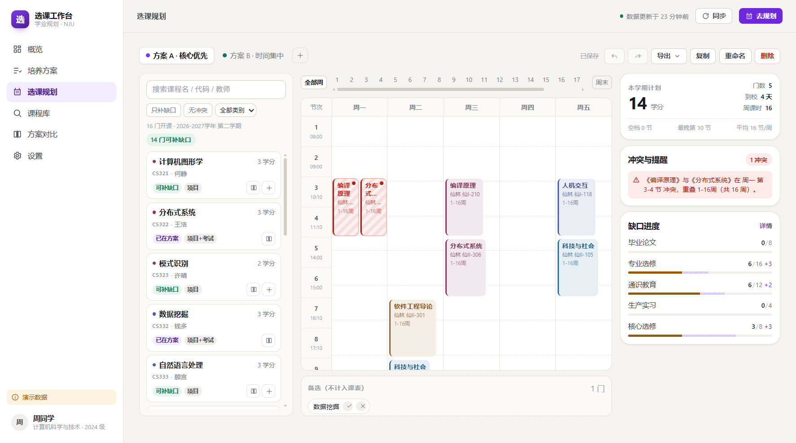

# 选课工作台 · 学业规划与选课决策辅助系统

> 南京大学场景的学业规划工具：把**培养方案、已修学分、开课信息、时间安排**放进同一张可以反复试选的图里。
> 正式选课仍然在学校系统完成；本项目只做**选课前的决策**。



## 宣传片

55 秒文字动效短片（无实拍，真实界面演示数据）：

[](选课工作台-宣传片.mp4)

[选课工作台-宣传片.mp4](选课工作台-宣传片.mp4) · [封面](video/cover.png)

制作流程、分镜脚本与重新生成方法见 [video/README.md](video/README.md) 和 [video/分镜脚本.md](video/分镜脚本.md)。

## 这是什么

一个「前端为主 + 轻后端」的课程项目骨架，已经可以运行、可以演示：

| 能力 | 状态 |
| --- | --- |
| 演示数据（2024 级计算机，159 学分培养方案，46 门已修） | ✅ 可运行 |
| **真实数据接入（软件工程 2024 级，150 学分，63 条成绩，3216 个教学班）** | ✅ 已跑通 |
| 培养方案进度核算（模块 / 已获 / 计划 / 缺口 / 可补足课程） | ✅ 可运行 |
| 规划工作台：课程池 + 周课表 + 学分账本 + 冲突清单 | ✅ 可运行 |
| 时间冲突（星期 / 节次 / 单双周 / 教学周） | ✅ 可运行 |
| 多方案对比（指标矩阵、覆盖度、逐门课差异） | ✅ 可运行 |
| 导出 Markdown / CSV / ICS 日历 | ✅ 可运行 |
| 课程库筛选与课程对比 | ✅ 可运行 |
| ehall 接口：课表 / 培养方案 / 成绩 / 开课 / 预警 | ✅ 已验证（见 `docs/02`） |
| 南大统一认证密码登录 | ⚠️ 学校已启用滑块验证，主路径改为 Cookie 导入 |
| 课组级培养要求（思政 16 学分等子模块） | ⛔ 未找到接口，v1 只做模块级核算 |
| 浏览器扩展导入、历史评价、先修关系 | ⛔ 不在 v0.1 范围 |

**边界**：只读、只处理本人数据、不写入教务系统、不破解验证码、不替代正式选课。
详见 [数据获取与合规](docs/02-数据获取与合规.md)。

## 快速开始

```bash
# 1. 安装依赖（需要 Node 22+、pnpm 10+）
pnpm install

# 2. 同时启动后端（8787）与前端（5173）
pnpm dev
```

打开 <http://localhost:5173>，点「进入工作台」即可看到完整界面，**不需要连接 ehall**。

### 接入真实数据

1. 在浏览器登录 <https://ehall.nju.edu.cn>（统一认证现在带滑块验证）。
2. 任选一种方式把会话交给本地：
   - **应用内**：登录页 →「粘贴 Cookie」；
   - **脚本**（推荐）：
     ```bash
     node apps/server/scripts/edge-cookies.mjs --domain nju.edu.cn --out apps/server/data/cookies.json
     pnpm --filter @planner/server sync:real
     ```
3. 也可以登录后在本应用「设置 → 数据来源 → 同步全部」（约 30–40 秒）。

同步会把培养方案、成绩、课表、开课、预警写进 `apps/server/data/db.json`，
并把原数据备份为 `db.demo.json`。只想改字段映射时用 `pnpm --filter @planner/server remap`，
不必重新抓取。

> 2026-11-08 实测：2026-2027-2 课表尚未发布，系统会自动回落到当前学期并标注；
> 待下学期课表发布后重新同步即可。

单独启动：

```bash
pnpm dev:server   # Fastify API，默认 127.0.0.1:8787
pnpm dev:web      # Vite，默认 5173，/api 代理到 8787
```

生产构建：

```bash
pnpm build        # 构建前端到 apps/web/dist
pnpm start        # 由 Fastify 同时托管 API 与静态资源，访问 8787
```

### 首次运行的两个坑

1. **pnpm 拦截 esbuild 安装脚本**：如果 `pnpm install` 报 `ERR_PNPM_IGNORED_BUILDS`，执行一次
   `pnpm approve-builds --all`。本仓库的 `pnpm-workspace.yaml` 已经声明允许 esbuild。
2. **会话在内存里**：改动后端代码会触发 `tsx watch` 重启，真实登录态随之失效（演示会话已做持久化，不受影响）。
   这是安全设计的一部分，不是 bug。

## 目录结构

```
.
├─ apps/
│  ├─ server/                 # 轻后端：认证代理 + 数据规范化 + 规则分析 + 持久化
│  │  ├─ src/
│  │  │  ├─ adapters/ehall/   # CAS 登录、CookieJar、jwapp 客户端、字段映射
│  │  │  ├─ routes/           # auth / data / plans / dev
│  │  │  ├─ services/         # 分析、课程检索、导出、会话
│  │  │  ├─ store/            # JSON 持久化 + 演示种子数据
│  │  │  └─ index.ts
│  │  └─ data/                # 运行期数据（已 gitignore，含个人信息）
│  └─ web/                    # Vue 3 + TS + Vite
│     └─ src/
│        ├─ views/            # 登录 / 概览 / 培养方案 / 规划 / 课程库 / 对比 / 设置
│        ├─ components/       # 课表网格、课程卡片、进度条、外壳
│        ├─ stores/           # session / data / planner（Pinia）
│        └─ utils/            # 本地分析与格式化
├─ packages/
│  └─ shared/                 # 前后端共用的领域模型与算法（周次位掩码、冲突、学分核算）
└─ docs/                      # 详细设计文档
```

## 技术选型与理由

| 选择 | 理由 |
| --- | --- |
| Vue 3 + TypeScript + Vite | 与选题建议一致；组合式 API 适合把「课表状态」拆成可复用单元 |
| 无 UI 组件库，自建设计令牌 | 界面是本项目的核心研究产出，套组件库会让交互被框架带着走；也便于离线演示 |
| Fastify + 本地 JSON | 「轻后端」只需要认证代理、规范化和规则计算；JSON 便于人工核对与答辩演示 |
| 前后端共用 `@planner/shared` | 保证「界面上的冲突提示」和「后端返回的分析」是同一份代码，避免两套口径 |
| 位掩码表示教学周 | 冲突判定退化为一次按位与，单双周、跳周都能统一处理 |

## 数据从哪来（已验证）

| 路径 | 说明 |
| --- | --- |
| **浏览器登录 + Cookie 导入**（主路径） | 统一认证已启用滑块验证，不在项目里绕过；登录一次后把会话交给本地 |
| **命令行同步** | `pnpm --filter @planner/server sync:real`，抓五类数据并重建本地库 |
| **应用内同步** | 「设置 → 数据来源 → 同步全部」，走同一个 `POST /api/sync` |
| **本地数据** | `{method:"demo"}` 建立本地会话，读取 `data/db.json`（可以是演示种子，也可以是真实同步结果） |
| **CAS 密码登录** | 已实现但受验证码限制；遇到滑块返回 `CAPTCHA_REQUIRED` 并引导降级 |

已验证的接口（详细字段见 [数据获取与合规](docs/02-数据获取与合规.md)）：

```
wdkb  /modules/xskcb/cxxsjbxx.do     学生信息
wdkb  /modules/xskcb/cxxskclb.do     我的课表
cjcx  /modules/cjcx/cxxscjd.do       成绩
qxfacx/modules/pyfacxepg/qxpyfacxzl.do   培养方案（按 PYFADM）
kcbcx /modules/qxkcb/qxfbkccx.do     开课与教学班
xyyj  /modules/xsxyyjjg/cxlbxssj.do  学业预警
```

两个坑：`modules/qxkcb.do` 只返回页面配置（数据在 `qxkcb/qxfbkccx.do`）；
2026-2027-2 课表尚未发布时接口返回提示而非空数组。

## 文档

| 文档 | 内容 |
| --- | --- |
| [01 产品方案](docs/01-产品方案.md) | 定位、用户与场景、目标/非目标、信息架构、功能优先级、成功指标 |
| [02 数据获取与合规](docs/02-数据获取与合规.md) | CAS 链路、ehall 数据结构、四种采集策略、探针与快照、合规边界 |
| [03 领域模型与算法](docs/03-领域模型与算法.md) | 数据模型、周次位掩码、冲突规则表、学分核算、指标口径、边界用例 |
| [04 系统架构与接口](docs/04-系统架构与接口.md) | 架构图、REST 接口表、错误码、状态管理、安全与性能 |
| [05 交互与视觉设计](docs/05-交互与视觉设计.md) | 页面与布局、关键任务流、状态设计、文案与无障碍、待验证假设 |
| [06 实施计划与验证](docs/06-实施计划与验证.md) | 里程碑、任务拆分、风险、测试与可用性验证方案 |

## 已验证的内容

```
pnpm typecheck   # shared / server / web 全部通过
pnpm test        # 19 个单测：周次解析、单双周冲突、学分分配、标签补齐
pnpm build       # 前端生产构建通过
```

界面已用真实浏览器逐页验证：本地进入 → 概览 → 培养方案 → 规划（加入 / 撤销 / 冲突）→
课程库（对比）→ 方案对比 → 设置。

真实数据回归（2026-11-08）：63 条成绩、1991 门课程、3216 个教学班、8 门在修，
培养方案 150 学分、四个模块缺口全部正确，课表无冲突。

## 许可与免责

课程作业项目，数据口径与南京大学教务系统无关；培养方案核算结果仅供参考，不构成选课依据。
项目中不包含任何真实学生信息，演示数据全部为虚构。
