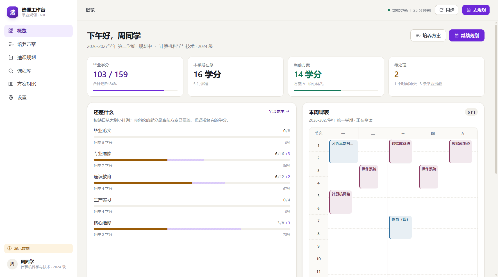
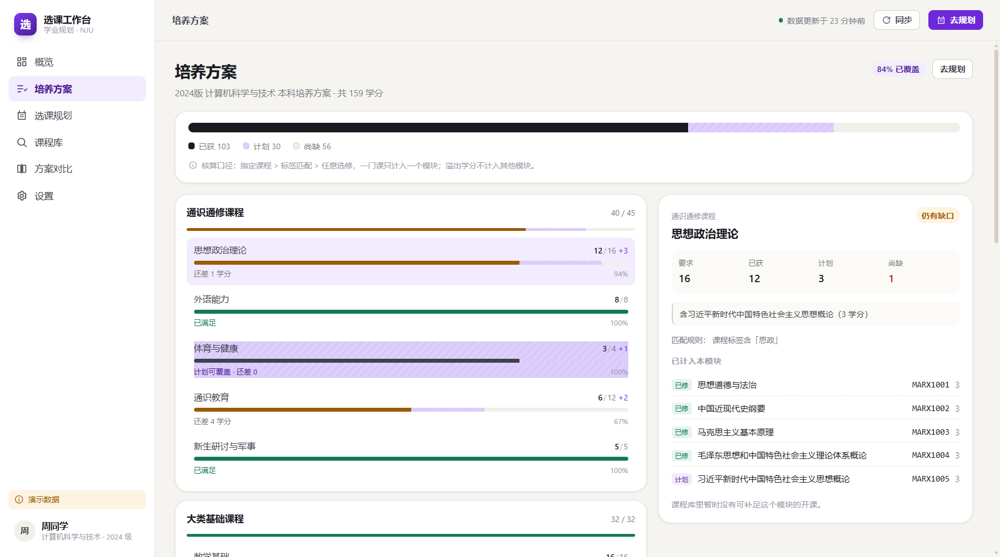
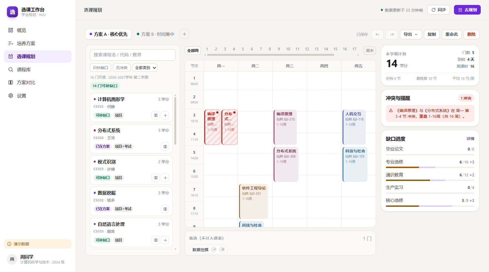
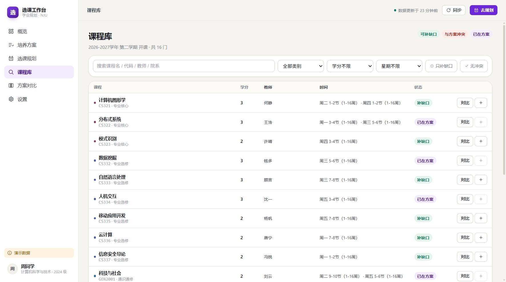
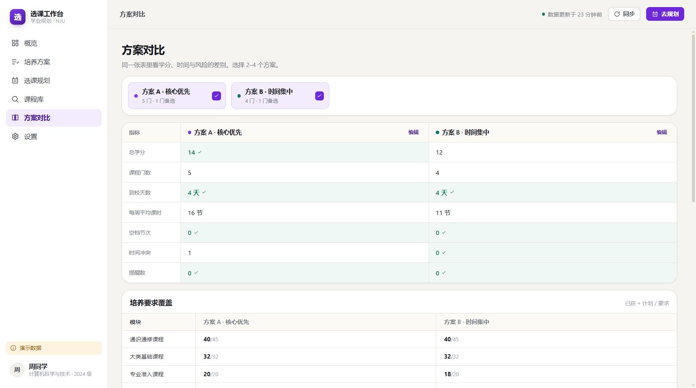

# 05 · 交互与视觉设计

> 本文回答：界面为什么长这样、每个页面解决哪个动作、状态怎么表达、哪些地方刻意不做。
> 对应实现：`apps/web/src/{views,components,styles}`。

---

## 1. 设计原则

| 原则 | 具体做法 | 反例（刻意避免） |
| --- | --- | --- |
| **同屏** | 规划页三栏并列：课程池 / 周课表 / 学分账本，同一屏内完成「找课—排课—看账」 | 弹窗里选课、跳到新页面看学分 |
| **即时** | 所有分析本地算，拖入即更新；网络只负责保存 | 每次拖拽转圈等后端 |
| **可解释** | 冲突说清「哪两门、周几、第几节、哪几周」；学分说清「按什么规则算进哪个模块」 | 一个红点、一句「有冲突」 |
| **可撤销** | 任何破坏性操作都有 `Ctrl+Z` 与 toast 撤销入口 | 删了就是删了 |
| **标注来源** | 每条数据带来源与时间；演示数据全程角标 | 把模拟数据当真数据展示 |
| **不替用户决定** | 不给「推荐方案」「最优解」，只给事实与对比 | 自动排序 + 一键采用 |

## 2. 视觉系统

### 2.1 色彩语义

| Token | 用途 | 取值 |
| --- | --- | --- |
| `--bg` | 页面底色（暖纸白） | `#f5f4f0` |
| `--surface` | 卡片 | `#ffffff` |
| `--ink` / `--ink-2` / `--muted` | 三级文字 | `#191b20` / `#3e424b` / `#767b85` |
| `--accent` | 主动作、当前方案 | `#6d28d9` |
| `--ok` | 已满足、无冲突 | `#14795a` |
| `--warn` | 提醒、数据过期 | `#9a5b06` |
| `--danger` | 时间冲突、删除 | `#b42318` |

课程类别色（课表格子左边框 + 课程卡圆点）：

| 类别 | 颜色 |
| --- | --- |
| 通识通修 | `#2f6f9f` 蓝 |
| 大类基础 | `#3f7d5a` 绿 |
| 专业准入 | `#a2601b` 棕 |
| 专业核心 | `#8b3a62` 紫红 |
| 专业选修 | `#4b5fa8` 靛 |
| 实践环节 | `#5f6b7a` 灰蓝 |

> 颜色只用于**分类**，不用于表达好坏。表达好坏只用语义色（ok/warn/danger），避免「紫色=好课」的误读。

### 2.2 字体与数字

- 正文 `Inter / PingFang SC / 微软雅黑`，13–14px，行高 1.55。
- 所有数字使用 `font-variant-numeric: tabular-nums`（`.num`），避免学分数字跳动。
- 标题层级：22（页面）/ 17（区块）/ 14（卡片）/ 13（正文强调）。

### 2.3 间距与圆角

- 8px 基准；卡片内边距 12–18px；页面最大宽度 1320px（对比页 1280，设置页 1040）。
- 圆角：控件 9px、卡片 12px、大卡片 18px。
- 阴影只用于浮层（抽屉、toast、下拉），卡片用 1px 边框表达层级。

## 3. 页面设计

### 3.1 登录 / 数据接入

**目标**：在不吓到用户的前提下取得数据接入授权。

布局：左侧「主张 + 三条收益 + 边界声明」，右侧三 Tab 卡片。

| Tab | 默认 | 说明 |
| --- | --- | --- |
| 演示数据 | ✅ 默认 | 一键进入，明确写「不访问 ehall」 |
| 南大统一认证 | | 学号 + 密码；写明「密码只换取一次会话，不落盘」 |
| 粘贴 Cookie | | 遇到验证码时的降级路径，附操作提示 |

错误展示：错误码翻译成人话 + 一行 hint（例如「校外请先连 VPN」），不展示堆栈。

### 3.2 概览

**目标**：30 秒内回答「我还差什么、这学期怎么安排」。

四张统计卡（毕业学分 / 在修 / 当前方案 / 待处理）+ 四块内容：
「还差什么」（按尚缺排序的模块条）、「本周课表」（压缩版周网格）、「我的方案」、「数据来源」。

细节：
- 缺口条用**实心 = 已获、斜纹 = 计划覆盖、空白 = 尚缺**，三种状态一眼可分。
- 「还差什么」按**尚缺**（扣掉计划）排序，而不是按「未获」——否则用户会被已覆盖的模块误导。
- 顶部问候语与学期并列，明确「现在规划的是下个学期」。

### 3.3 培养方案

**目标**：回答「要求是什么、这门课算哪一块」。

左列：模块卡片（父级进度条 + 子项进度条），点击子项在右侧联动。
右侧：明细面板——要求 / 已获 / 计划 / 尚缺四个数字、规则说明、已计入课程、可补足课程（可直接加入方案）。

细节：
- 「匹配规则」一行直接写出：`课程标签含「思政」`，让用户能判断差异。
- 「可补足课程」标注学分、院系、上课时间；点「加入」直接进当前方案。
- 顶部一行说明核算口径，随时可核对。

### 3.4 选课规划（核心）

**目标**：让「加一门课会怎样」在 100ms 内可见。

三栏：

| 栏 | 宽度 | 内容 |
| --- | --- | --- |
| 课程池 | 274px | 搜索、只补缺口、无冲突、类别筛选、课程卡（可拖拽） |
| 周课表 | 自适应 | 方案标签、全部周/第 N 周、周末开关、网格、备选区 |
| 学分账本 | 286px | 学分/门数/到校天数/周课时/空档、冲突与提醒、缺口进度 |

关键交互：

1. **拖拽加入**：拖动课程卡到任意格子 → 加入该课程（时间由排课决定，不能拖到别的时间）。空课表显示引导文案。
2. **一键加入**：`+` 自动挑一个不与现有课程冲突的教学班；若所有教学班都冲突，仍然加入并提示。
3. **周次切换**：默认「全部周」（并集）；点第 N 周只看该周——单双周不用再脑补。
4. **冲突高亮**：只有真正重叠的那一格变红斜纹，不是整门课标红。
5. **点块看详情**：右下角抽屉显示教学班、时间、地点、考核、简介，可「移入备选」或「移出方案」。
6. **备选区**：想选但没定的课放这里，不占课表、不计学分。
7. **撤销**：顶栏按钮 + `Ctrl+Z`；toast 上也有「撤销」。

为什么默认隐藏周末：7 列在 1280 宽屏里每列不足 70px，课程名会被拆成竖排；5 列后每列 ~95px，可读性显著提升。
周末课通过「周末」开关显示（有周末课时开关会以强调色提示）。

### 3.5 课程库

**目标**：跨课程比较，而不是逐门点开。

表格列：课程（名称/代码/类别）、学分、教师、时间、状态、操作。
筛选：关键词、类别、学分下限、星期、只补缺口、无冲突。

状态角标只有五种：`补缺口`、`已在方案`、`已修`、`冲突`、`可选`。
选中「对比」后底部浮出对比条，最多 4 门，8 个字段并排（学分/类别/院系/教师/时间/教学班/考核/简介）。

### 3.6 方案对比

**目标**：回答「A 和 B 到底差在哪」。

三块：
1. **指标矩阵**：总学分、门数、到校天数、周课时、空档、冲突、提醒；更优值浅绿底 + ✓。
2. **要求覆盖**：模块 × 方案，显示「已获+计划 / 要求」。
3. **逐门课程**：课程 × 方案，`已选 / 备选 / —`，冲突课程追加红色计数。

### 3.7 设置

**目标**：把「数据怎么来的」讲清楚。

数据来源列表（每项带模式、状态、更新时间、原始 URL、同步按钮）、作息表、接口探针、边界与隐私清单。

## 4. 状态设计

每个页面都必须回答「空、加载、部分失败、过期」四种状态，否则真实使用时会显得不可靠。

| 状态 | 表现 | 文案示例 |
| --- | --- | --- |
| 空 | 虚线引导 + 下一步动作 | 「还没有课程 —— 从左侧加入，或把课程卡片拖进来。」 |
| 加载 | 骨架/转圈 + 一句解释 | 「正在整理你的培养方案、课表与方案…」 |
| 部分失败 | 其他模块正常，失败来源标黄 | 「本学期课表：需更新」+「同步」按钮 |
| 数据过期 | 顶栏圆点变黄 | 「数据更新于 2 天前」 |
| 保存失败 | 顶栏红字，不回滚本地 | 「保存失败」+ 下次操作自动重试 |
| 会话过期 | 跳登录页并保留目标路由 | `?redirect=/planner` |

## 5. 文案规范

| 场景 | 写法 | 不这么写 |
| --- | --- | --- |
| 冲突 | 「《编译原理》与《分布式系统》在 周一 第 3-4 节 冲突，重叠 1-16周（共 16 周）。」 | 「时间冲突」 |
| 学分 | 「还差 1 学分」/「计划可覆盖 · 还差 0」 | 「未完成」 |
| 来源 | 「数据更新于 13 分钟前」 | 「上次同步」 |
| 边界 | 「正式选课仍由学校系统完成」 | 「一键选课」 |
| 失败 | 「会话已过期，请重新登录」 | 「Error 401」 |

语气：**陈述事实，不评判系统**。参考四场景脚本的取舍——不出现「教务系统好烂」，只说「原来要在几个地方之间来回」。

## 6. 无障碍与键盘

- 所有可点击元素有 `:focus-visible` 外框（2px accent）。
- 抽屉、菜单可用 `Esc` 关闭；课程块是 `<button>`，可用 Tab 到达。
- 颜色不是唯一信息载体：冲突同时有斜纹、圆点与文字；进度同时有数字与百分比。
- 尊重 `prefers-reduced-motion`：动效降为 0.01ms。
- 快捷操作：
  | 快捷键 | 作用 |
  | --- | --- |
  | `Ctrl/Cmd + Z` | 撤销 |
  | `Ctrl/Cmd + Shift + Z` | 重做 |
  | `Esc` | 关闭详情抽屉 |

## 7. 响应式

| 断点 | 变化 |
| --- | --- |
| ≥ 1240px | 三栏完整展示 |
| 1100–1240px | 隐藏右侧账本（冲突仍在课表上可见） |
| < 1100px | 培养方案详情改为下方堆叠 |
| < 1080px | 侧栏收为图标 |
| < 900px | 登录页隐藏左侧主张 |

移动端未做专门适配：任务（排课、对比）本身需要横向空间，强行适配会牺牲核心体验。
这是明确的取舍，不是遗漏。

## 8. 与四场景脚本的对应

| 脚本场景 | 痛点 | 界面上的解法 |
| --- | --- | --- |
| 一 · 搬运工 | 5 个页面手抄 | 一次接入后所有数据同屏；「数据来源」标明哪来的 |
| 二 · 叠片 | 学分/课程/时间看不见 | 规划页三栏同屏，账本随课表实时更新 |
| 三 · 两列便利贴 | 比较时不知道年份 | 课程卡带来源与更新时间；对比条并排字段 |
| 四 · 三张课表 | 不敢试 | 复制方案 + 撤销 + 对比矩阵，试错成本为零 |

## 9. 待验证的交互假设

以下是设计时做出的判断，**必须用测试验证**，不要当成结论：

| 假设 | 如果错了，怎么改 |
| --- | --- |
| 三栏同屏比「列表 + 弹窗」更高效 | 改为两栏 + 抽屉，把账本折叠成顶部条 |
| 默认 5 天比 7 天好 | 提供开关（已提供），根据测试切换默认值 |
| 冲突精确到格子比整门标红更好理解 | 增加一个「整门标红」的开关做 A/B |
| 「尚缺」比「未获」更符合直觉 | 两者同时展示，观察用户引用哪个 |
| 备选区会被使用 | 若无人使用，合并进方案（标记为「想选」）并简化 |

## 10. 可用性测试任务草案

**任务**：给定条件——「下学期要修完核心必修，社会科学类还差 4 学分，周三全天不在校」——请制定一套无冲突方案并导出清单。

观察点：
1. 首次进入是否知道点哪里（登录 → 规划）；
2. 是否使用「只补缺口」筛选；
3. 遇到冲突时是否理解文案、是否找到替换教学班；
4. 是否使用了撤销/对比；
5. 导出是否成功。

记录：完成时间、视图切换次数、错误操作次数、求助次数、SUS、主观难度。
（详见 [06 实施计划与验证](06-实施计划与验证.md)）

---

**下一步**：怎么排期与验证 → [06 实施计划与验证](06-实施计划与验证.md)
